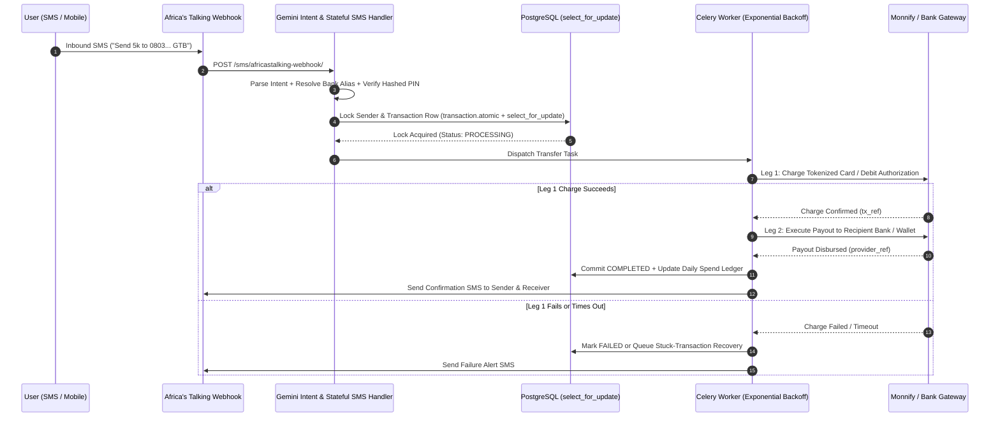

# BUYBY — AI-Powered SMS & Offline-First Fintech Settlement Engine
**Repository Visibility:** 🔒 Private Commercial Fintech Repository

---

## 1. Executive Summary
**BUYBY** is an offline-accessible fintech transaction engine built in **Python 3.12, Django 5.2, PostgreSQL, Celery, and Redis** that enables users to execute peer-to-peer (`BuyBy-to-BuyBy`), inter-bank (`BuyBy-to-Bank`), bulk, and scheduled money transfers via **SMS** without requiring mobile data or a smartphone.

It combines **Africa's Talking** and **Twilio** SMS gateways with **Google Gemini AI** natural-language intent parsing and a **2-leg atomic settlement pipeline** powered by **Monnify** and **Flutterwave**.

---

## 2. Two-Leg Atomic Settlement & Concurrency Architecture

---

## 3. Core Backend Engineering Highlights

### A. Race-Condition Prevention & Row-Level Locking
- All single, bulk, and scheduled transfer executions acquire a row-level lock (`select_for_update()`) inside `django.db.transaction.atomic()` before transitioning a transaction from `pending` to `processing`.
- Prevents double-spending when duplicate SMS webhooks or concurrent Celery workers attempt to process the same transfer reference simultaneously.

### B. Two-Leg Financial Settlement (`Monnify` & `Flutterwave`)
- **Leg 1 (Collection):** Charges the sender's tokenized card authorization via `MonnifyService.charge_authorization` using deterministic transaction references (`SCHED-{id}`) for idempotency.
- **Leg 2 (Disbursement):** Routes payouts either internally (`buyby_to_buyby`) or externally (`buyby_to_bank`) after resolving bank codes and cached bank aliases (`gtb`, `gt`, `guaranty` → bank code) via Flutterwave/Monnify directory services.

### C. Natural-Language SMS Banking & Stateful Sessions
- Users can interact via structured SMS menus or natural language (parsed by `buyby/ai/gemini.py` and `intents.py`).
- Multi-step flows (recipient confirmation, fee disclosure, and PIN entry) are tracked via Redis-backed stateful SMS sessions (`buyby/sms/sessions.py`).

### D. Fintech Security Controls & Automated Recovery
- **PIN Security:** Transaction PINs are hashed using Django's PBKDF2/Argon2 password hashers (`make_password` / `check_password`). Consecutive failed PIN attempts increment `failed_pin_attempts` and automatically lock the account (`is_locked=True`).
- **Automated Recovery (`buyby/services/recovery.py`):** Periodic Celery tasks (`retry_failed_transfers`, `resolve_stuck_transactions`) reconcile in-flight transactions with Monnify's transaction status API and execute automatic retries with exponential backoff (`max_retries=3, retry_backoff=60`).

---

## 4. Automated Test Suite Coverage (13 Test Modules)
Validated by 13 test suites in `buyby_project/buyby/tests/`:
- `test_send_money.py` & `test_send_money_ai.py` (Single transfers & Gemini NLP intent routing)
- `test_bulk_transfer.py` & `test_scheduled_transfer.py` (Batch normalization & Celery scheduled execution)
- `test_security.py` (PIN hashing, brute-force account lockouts & daily spending limits)
- `test_webhooks.py` (Monnify webhook signature verification & idempotent state transitions)
- `test_sms.py` & `test_sms_local.py` (Stateful SMS session transitions)
