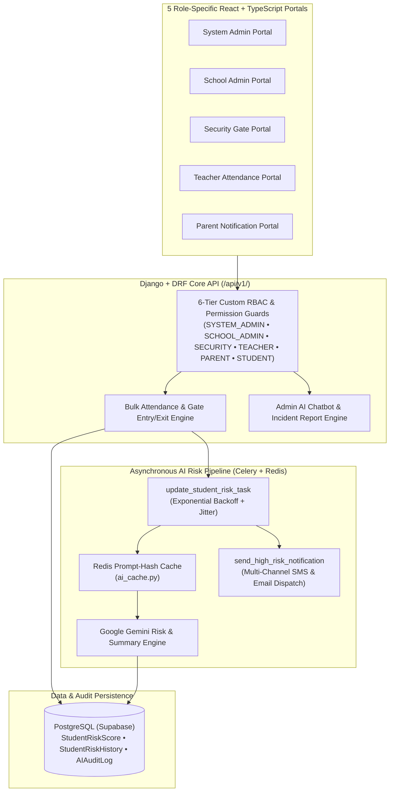

# GuardianLink — Multi-Tenant School Safety & AI Behavioral Risk Platform
**Repository Visibility:** 🔒 Private Repository *(Architecture & System Design Case Study)*

---

## 1. Executive Summary
**GuardianLink** is a multi-tenant school safety, gate entry/exit tracking, classroom attendance, and AI behavioral risk-scoring platform built in **Python, Django, Django REST Framework (DRF), PostgreSQL (Supabase), Celery, Redis, Google Gemini AI, and React + TypeScript**.

---

## 2. System Architecture & 6-Tier RBAC Pipeline

---

## 3. Core Backend Engineering Highlights

### A. 6-Tier Role-Based Access Control (`backend/core/models.py`, `permissions.py`)
- Custom `User` model (`USERNAME_FIELD = 'email'`) with strict role isolation (`SYSTEM_ADMIN`, `SCHOOL_ADMIN`, `SECURITY`, `TEACHER`, `OTHER_STAFF`, `STUDENT`, `PARENT`) and custom queryset managers (`StudentQuerySet`) ensuring school admins and teachers can only query records belonging to their registered institution.

### B. Asynchronous AI Behavioral Risk Engine (`backend/core/tasks.py`, `backend/ai/services/`)
- `update_student_risk_task` runs asynchronously via **Celery** with automatic retry (`autoretry_for=(Exception,), retry_backoff=30, max_retries=3, retry_jitter=True`).
- Evaluates attendance anomalies and incident reports using **Google Gemini**, stores longitudinal risk trajectories in `StudentRiskHistory`, and logs input/output prompt hashes in `AIAuditLog` for governance and auditability.
- When a student's risk level crosses into `HIGH`, `notify_high_risk_student` dispatches immediate **SMS** (via Africa's Talking / Twilio) and **Email** alerts to school administrators and assigned teachers.
