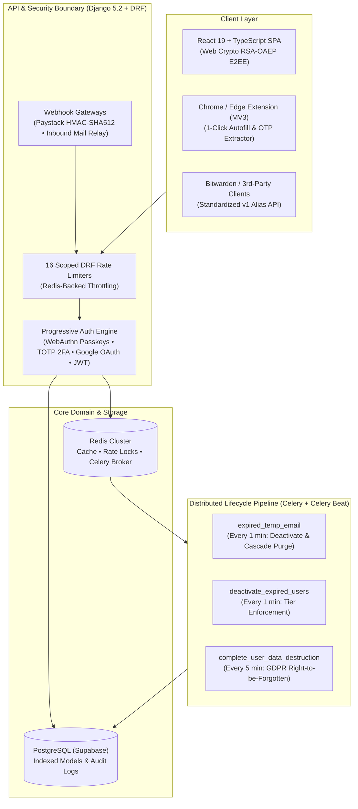

# TMailme — System Architecture & Security Case Study
**Live Production Platform:** [https://www.tmailme.com](https://www.tmailme.com)  
**Repository Visibility:** 🔒 Private Commercial Repository *(Zero-Knowledge Disposable Email, Shield Aliasing & Developer API)*

---

## 1. Executive Summary
**TMailme** is a production privacy-first email infrastructure platform serving instant disposable inboxes, anonymous guest sessions, permanent **Tmailme Shield** forwarding aliases, a **Bitwarden-compatible v1 REST Developer API**, and a **Chrome/Edge Manifest V3 Browser Extension**.

The backend is engineered in **Python 3.12, Django 5.2, and Django REST Framework (DRF)** backed by **PostgreSQL (Supabase)**, **Redis**, and **Celery + Celery Beat**, with real-time error and performance profiling via **Sentry**.

---

## 2. High-Level System Architecture

---

## 3. Core Engineering Decisions

### A. Zero-Knowledge End-to-End Encryption (RSA-OAEP JWK)
- **Challenge:** Standard temporary email services store incoming message bodies in plaintext on the server, creating a privacy risk.
- **Solution:** Implemented browser-side **Web Crypto API RSA-OAEP** keypair generation. The client registers only the public key (`JWK JSON`) via `/api/email/public-key/`. The private key never leaves the user's browser storage, enabling zero-knowledge message decryption on the client.

### B. Progressive Authentication & Passwordless Security
- Implemented full **WebAuthn / Passkey** registration and challenge-response verification (`/api/auth/passkey/register-options/`, `/api/auth/passkey/login-verify/`).
- Supported **TOTP 2FA** setup/verification, **Google Identity OAuth 2.0**, and **SimpleJWT** with refresh-token rotation and explicit token blacklisting on logout or account expiry.

### C. Defense-in-Depth Rate Limiting (16 Scoped Throttles)
- Built 16 granular DRF throttle classes (`LoginThrottle`, `SignupThrottle`, `PasskeyThrottle`, `GuestInboxThrottle`, `PaystackWebhookThrottle`, `EmailWebhookThrottle`, `DeveloperApiThrottle`, `ShieldAliasThrottle`, etc.) backed by **Redis** to isolate abusive traffic without degrading legitimate inbox polling.

### D. Automated Data Lifecycle & GDPR "Right to be Forgotten"
- **Celery Beat** executes deterministic cleanup tasks:
  - `expired_temp_email` (every 60s): Identifies expired addresses (`expires_at <= now`), marks them inactive, and cascade-purges associated `MailMessage` rows in a single atomic transaction.
  - `complete_user_data_destruction` (every 5m): Permanently purges expired user records, outstanding/blacklisted JWT tokens, and active sessions.

### E. Chrome & Edge Manifest V3 Extension
- Content scripts detect `<input type="email">` across any webpage and inject a 1-click TMailme autofill trigger.
- Background service worker polls the active mailbox, extracts 4-, 6-, and 8-digit OTP verification codes via regex heuristics, and dispatches native OS notifications with a 1-click **"Copy Code"** clipboard action.

---

## 4. Automated Test Suite Coverage (19 Test Modules)
The backend is validated by 19 dedicated test modules in `backend/mail/tests/`:
- `test_authentication.py` & `test_progressive_security.py` (JWT, 2FA, Passkeys)
- `test_idor_security.py` (Cross-tenant Inbox Insecure Direct Object Reference prevention)
- `test_rate_limiting.py` & `test_fair_limits.py` (Scoped throttling & plan quota enforcement)
- `test_payments.py` & `test_webhooks.py` (Paystack HMAC-SHA512 webhook verification & idempotency)
- `test_v1_alias_api.py` (Bitwarden-compatible developer API endpoints)
- `test_data_deletion.py` & `test_timer_functionality.py` (Celery Beat lifecycle & GDPR purging)
