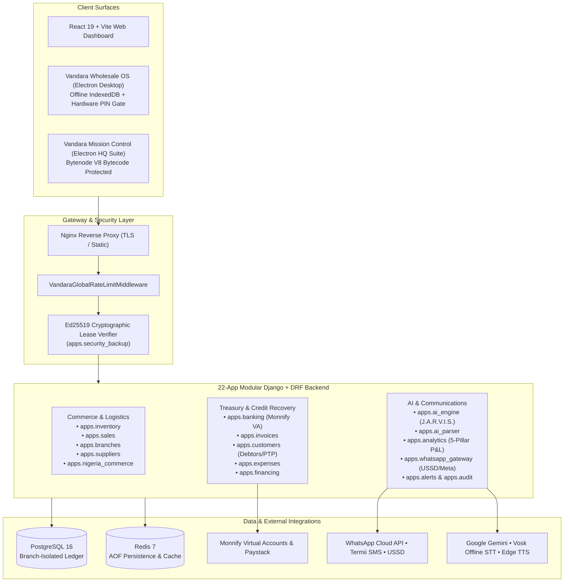

# Vandara Wholesale OS — System Architecture & Engineering Case Study
**Repository Visibility:** 🔒 Private Commercial Repository *(Vandara Software & Digital Solutions Limited)*

---

## 1. Executive Summary
**Vandara Wholesale OS** is a multi-tenant commercial ERP, offline-capable Point of Sale (POS), financial clearinghouse, and multimodal voice AI platform built for high-velocity wholesale and retail distribution networks across Nigeria and Africa.

The platform combines a **22-app modular Django & Django REST Framework backend**, **PostgreSQL**, **Redis**, and **Docker + Nginx** with a **45+ component React 19 spatial dashboard** and two standalone **Electron** Windows desktop suites (`Vandara Wholesale OS` and `Vandara Mission Control`) protected via V8 bytecode compilation (`bytenode`).

---

## 2. Multi-Tenant & Modular Backend Architecture (22 Django Apps)

---

## 3. Key Engineering Subsystems

### A. Multi-Branch Stock Isolation & Atomic Inter-Branch Transfers (`apps.branches`, `apps.inventory`)
- **Problem:** Wholesale merchants operate central depots alongside multiple market stalls, leading to inventory drift and unrecorded in-transit stock.
- **Engineering Solution:** Enforced tenant- and branch-scoped query isolation across all SKU mutations. Inter-branch transfers use atomic database transactions with explicit `IN_TRANSIT` ledger states, waybill/transporter metadata (`apps.nigeria_commerce`), and destination receipt confirmation before incrementing target branch stock.

### B. Automated Treasury, Virtual Accounts & Debtor Credit Recovery (`apps.banking`, `apps.customers`, `apps.whatsapp_gateway`)
- Integrated **Monnify Reserved Virtual Accounts** and **Paystack** webhooks to automatically reconcile incoming bank transfers against open invoices and customer credit ledgers.
- Built a **Debtors Aging & Promise-to-Pay (PTP)** engine that tracks overdue credit brackets and dispatches automated payment reminders via **WhatsApp Cloud API** and **Termii SMS**, plus a **USSD gateway** (`ussd_views.py`) for offline merchant interactions.

### C. J.A.R.V.I.S. Multimodal Voice & Commercial Intelligence Engine (`apps.ai_engine`, `apps.analytics`)
- Engineered a hybrid voice/text copilot combining **Vosk** (offline speech recognition), **Google Gemini** (multimodal intent parsing & structured extraction), and **Edge TTS** (neural voice synthesis).
- Tuned specifically for Nigerian commercial English and Pidgin market phrasing to support hands-free warehouse restocking, sales logging, and real-time **5-Pillar Business Health Diagnostics** (Revenue Velocity, Net Margin, Inventory Depth, Debt Risk, Overhead Control).

### D. Cryptographic Desktop Licensing & Offline-First Resilience (`apps.security_backup`, `electron`)
- Implemented **Ed25519 asymmetric cryptographic lease signing** (`crypto_leases.py`) to validate offline desktop terminal entitlements without vulnerable plaintext license checks.
- Compiled Electron main-process logic into native **V8 bytecode (`.jsc`)** via `bytenode` to protect commercial IP on client POS hardware.

---

## 4. Verification & Mathematical Invariant Testing (35+ Test Suites)
- Includes dedicated invariant verification suites such as `test_pnl_mathematical_invariants.py` (ensuring Gross Revenue − COGS − Operating Expenses strictly reconciles across split-payment POS orders, credit settlements, and refunds), `test_model1_virtual_accounts.py`, `test_pillar3_cybersecurity.py`, and `test_rate_limiting.py`.
